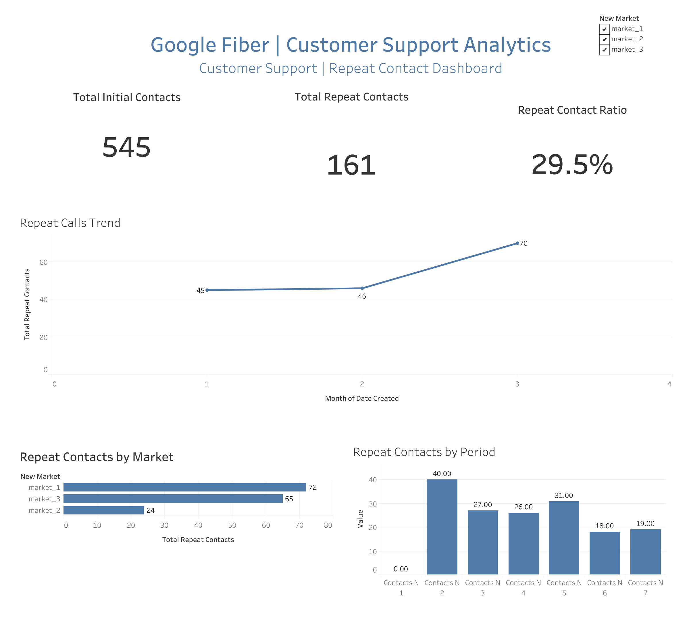

# Google Fiber | Customer Support Analytics

**Business Intelligence portfolio project using Google BigQuery, SQL, and Tableau Public**

[**View the interactive Tableau dashboard**](https://public.tableau.com/app/profile/maira.taimoor/viz/GoogleFiber_17931261459750/Dashboard1)

## Dashboard Preview

## Project overview

This project explores customer-support repeat contacts across three markets. The goal is to help stakeholders monitor support demand, compare markets, and identify patterns worth investigating to improve the customer experience.

## Tools and skills

- **Google BigQuery and SQL:** Combined three market tables (`market_1`, `market_2`, `market_3`) into a unified reporting dataset using `UNION ALL`.
- **Tableau Public:** Built an interactive dashboard with KPI cards, monthly trends, market comparisons, and repeat-contact period analysis.
- **Business intelligence:** Defined reporting metrics, documented stakeholder needs, and designed visuals for decision-making.

## SQL Data Preparation

Used Google BigQuery and SQL to consolidate three
customer support market datasets into a unified
reporting table using UNION ALL.

### SQL Techniques
- UNION ALL
- Data consolidation
- Data preparation for BI reporting

### SQL Query
[View BigQuery SQL Query](sql/create_target_table.sql)

## Dashboard KPIs

| Metric | Reported value |
|---|---:|
| Initial contacts | 545 |
| Repeat contacts | 161 |
| Repeat-to-initial contact ratio | 29.5% |
| Markets analyzed | 3 |

**Metric note:** The 29.5% figure is `161 / 545`. It compares repeat-contact volume with initial-contact volume; it is **not** a verified percentage of unique customers who contacted support again.

## Key findings

- **Monthly repeat contacts:** January 2022 — 45; February — 46; March — 70.
- **Repeat contacts by market:** `market_1` — 72; `market_3` — 65; `market_2` — 24.
- **Repeat contacts by reporting period:** N1 — 0, N2 — 40, N3 — 27, N4 — 26, N5 — 31, N6 — 18, N7 — 19.

These are descriptive findings; they do not establish why customers contacted support again.

## Dashboard components

1. Initial Contacts KPI
2. Repeat Contacts KPI
3. Repeat-to-Initial Contact Ratio KPI
4. Monthly Repeat Calls Trend
5. Repeat Calls by Market
6. Repeat Contacts by Period

The dashboard also includes a market selection filter.

## Workflow

1. Reviewed the business problem and reporting requirements.
2. Consolidated three market datasets in BigQuery.
3. Prepared a unified table for analysis and visualization.
4. Built Tableau worksheets and arranged them into a dashboard.
5. Compared repeat-contact patterns across time, markets, and reporting periods.

## Business recommendations

- Investigate the drivers of repeat contacts in markets with higher repeat-contact volumes.
- Review the increase in repeat contacts observed in March 2022.
- Pair repeat-contact counts with market-level initial-contact volumes before interpreting relative performance.
- Explore contact reasons and resolution outcomes, if those data become available.

## Dashboard

**[Open the live dashboard on Tableau Public](https://public.tableau.com/app/profile/maira.taimoor/viz/GoogleFiber_17931261459750/Dashboard1)**

## Notes

This repository documents the dashboard and analytical approach. Source data and SQL scripts are not included in this initial version. Add them later only if available and permitted for public sharing.
